<div align="center">

# Hallownest Forge

**A mod manager for Hollow Knight — with a built-in Modding API builder.**

[](#requirements)
[](#download)
[](#languages)

**English** · [Русский](README.ru.md)

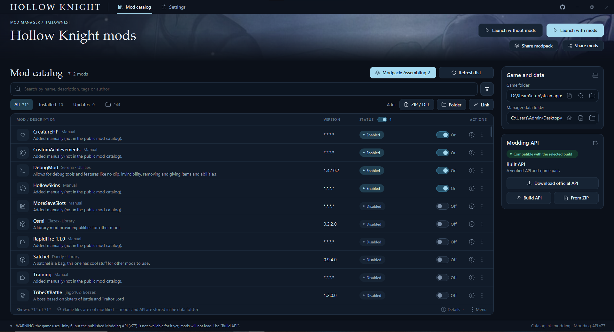

</div>

> **Safe for your game.** Hallownest Forge does not break or modify your Hollow Knight game data — mods, the Modding API and backups live in the program's own data folder, so your installation stays exactly as it was.

---

## Download

Grab **`HallownestForge.exe`** from the [latest release](https://github.com/SilentPixel-art/HallownestForge/releases/latest) and run it. There is no installer and nothing else to install.

## Requirements

- Windows 10 (version 1903 or newer) or Windows 11
- Hollow Knight installed on your PC
- Internet connection for the mod catalog and for downloading mods

The program is a single ~1 MB `.exe` built on .NET Framework 4.8, which is already part of Windows 10 (1903+) and Windows 11.

## Highlights

### Modding API — your own build, made from your game files

The *Modding API* card in Settings gives you three ways to connect the API, and a status badge that tells you whether the API matches the selected game build:

- **Download official API** — one click, ready-made API.
- **Build API** — builds the Modding API from your own game files, so the API and the game are a verified pair.
- **From ZIP** — install an API archive you already have.

<p align="center">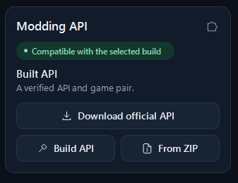</p>

More on the API side:

- **Auto-connect API** — the API is connected whenever you start the game (the program must be open or in the tray).
- A full **API build log** is one click away if something goes wrong.
- **It doesn't break your game data.** Game files are never modified — mods and the API live in the program's own data folder.
- **The API build follows Unity 6** — it is made against the game's own Unity 6 assemblies, so the API matches the current game build.
- If the published API does not support the game's current build yet (for example, a new Unity 6 build), **Build API** makes mods work anyway.
- The build needs the .NET SDK 10; if it is missing, the program offers to download it from the official Microsoft site into its own folder — no administrator rights needed.

### Mod catalog

- Hundreds of mods from the **hk-modding** catalog, with descriptions, authors and tags.
- Instant **search** (`F3`) and **filters**: sorting, dependencies, install status, and tags — click a tag once to include it, twice to exclude it, a third time to reset. A switch lets you require *all* selected tags at once.
- **Install, update, disable and remove** mods in a click; **Update all** and optional **auto-update**.
- **Dependencies** are installed together with the mod (can be turned off).
- Add a mod **from a file, a folder or a link** in the clipboard (`Ctrl+V`).

<p align="center"></p>

<p align="center">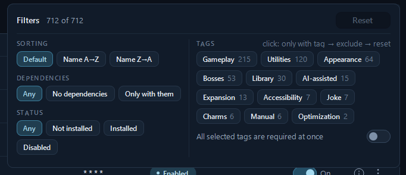</p>

### Screenshots viewer

Every mod page has a gallery. The built-in viewer supports thumbnails, zoom, fit-to-window, full screen and keyboard navigation.

<p align="center">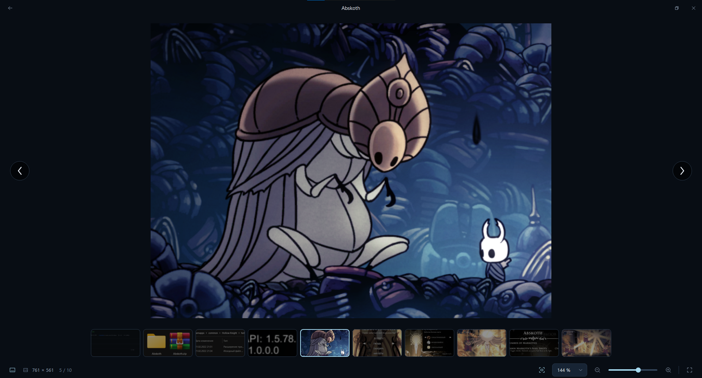</p>

### Modpacks

Save the current set of enabled mods as a **modpack**, switch between modpacks in a click (`Alt+0…9`), rename or delete them, start from an empty one ("everything off"), and **pack a modpack into a zip** to share it. Imported packs are supported too.

<p align="center">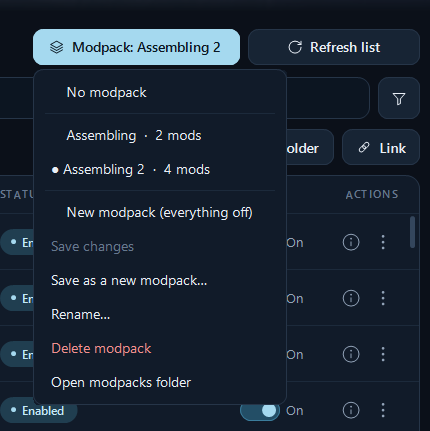</p>

### Share your mods

**Share modpack** and **Share mods** pack what you have into a zip. Choose what goes in: all installed mods, only enabled ones, only those downloaded from the catalog, only those added manually — and optionally the mods' saves.

<p align="center">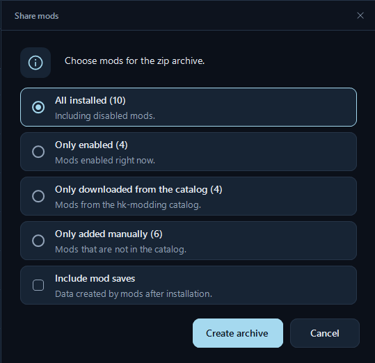</p>

### Launch and shortcuts

- **Launch with mods** or without mods.
- Create **desktop / Start menu shortcuts** for "with mods", "without mods" or for a specific modpack — with your own icon.

<p align="center">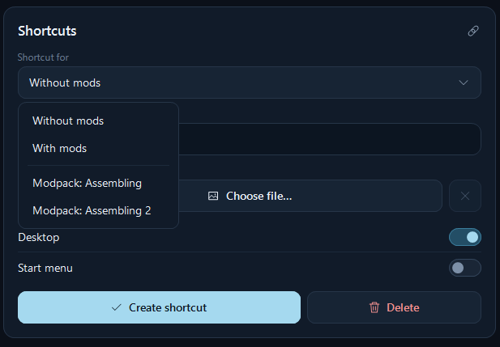</p>

### Diagnostics and rollback

If the game closes unexpectedly, **Diagnostics** reads the logs and lists the suspected mods with a probability for each — pick the culprits and disable them in one click.
Optional **version backups** let you roll mods back to an earlier version.

<p align="center">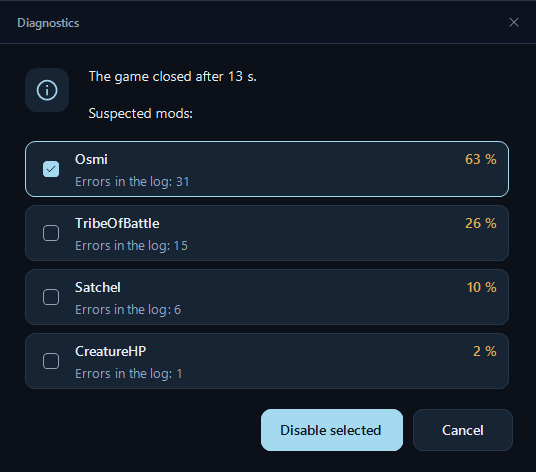</p>

### AppDataMOD — keep mod files out of AppData

One switch moves the files that mods write into AppData to a separate **AppDataMOD** folder (game saves are not touched, and the `ModLog.txt` path follows). You can open or clear the folder from Settings.
Saves of removed mods are kept in **ModData** unless you tell the program to delete them.

<p align="center">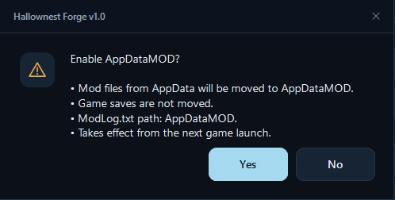</p>

<p align="center">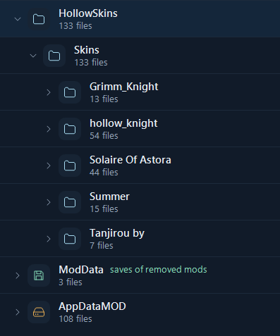</p>

### Banner

Custom header **banner** — choose a file, paste with `Ctrl+V` or drop an image in (animations are supported). Fit modes, alignment, edge fill with blur, bottom fade and compression are adjustable, with a live preview.

<p align="center">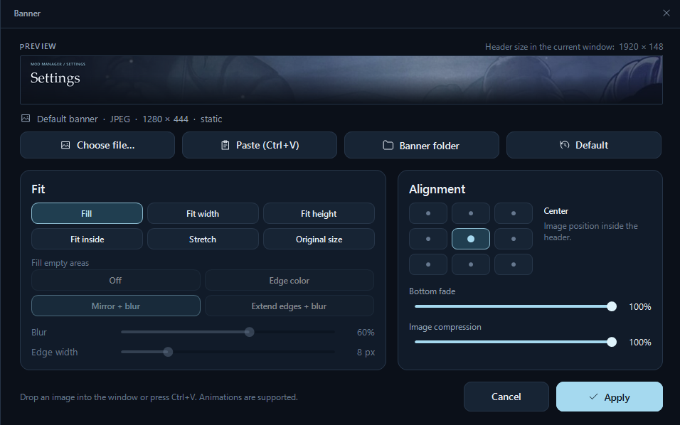</p>

### Everything else

- **11 interface languages**, plus editable `.lang` translation files (see [Languages](#languages)).
- Tray mode, start with Windows, interface scale (100 % and up).
- Full keyboard control — press **F1** for the list of shortcuts.
- Tooltips on the controls.

<p align="center">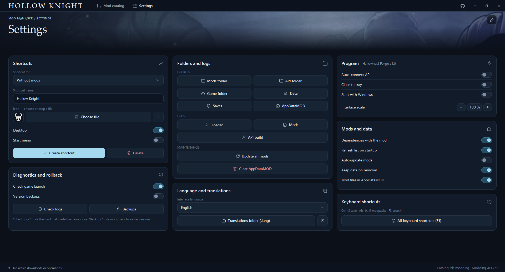</p>

## Languages

Deutsch · English · Español · Français · Italiano · Português (Brasil) · Русский · 日本語 · 简体中文 · 繁體中文 · 한국어

Translations are plain text `.lang` files. Open **Settings → Translations folder (.lang)**, edit or add a file, and it shows up in the language list.

<p align="center">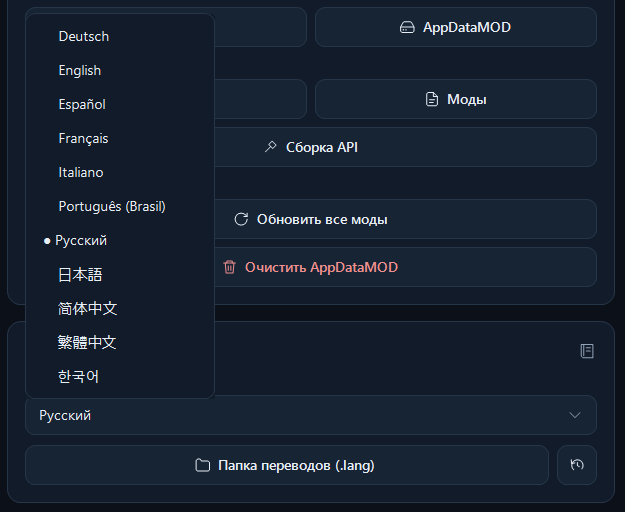</p>

## Where the data lives

Everything the program stores is in `%LOCALAPPDATA%\HallownestForge` (settings, modpacks, backups, logs, `AppDataMOD`, `ModData`).

Diagnostic logs (`launch.log`, `hkloader_boot.log`, `crash.log`) are in the same folder. The API build log opens from **Settings → API build**.

## Building from source

The source is in [`src/`](src). The program is C# (WinForms + GDI+) targeting .NET Framework 4.8; the in-game loader `hkloader` is native C++ and is embedded into the exe.

Requirements to build:

- .NET SDK 6 or newer (only for building) and internet on the first build
- Python 3
- Visual Studio Build Tools (C++) **or** MinGW-w64 — for `hkloader.dll`, if it is not already next to the script

```bat
cd src
python build.py
```

The result is `HallownestForge.exe`; build errors go to `build.log`. Details are in [`src/README.txt`](src/README.txt) (in Russian).

## Credits and notes

- Hollow Knight is a game by Team Cherry. Hallownest Forge is an unofficial fan-made tool and is not affiliated with Team Cherry.
- The mod catalog and the Modding API come from the [hk-modding](https://github.com/hk-modding) community. All mods belong to their respective authors.
- Bugs and ideas are welcome in [Issues](https://github.com/SilentPixel-art/HallownestForge/issues).
