<div align="center">

# Hallownest Forge

**Менеджер модов для Hollow Knight со встроенной сборкой Modding API.**

[](#требования)
[](#скачать)
[](#языки)

[English](README.md) · **Русский**

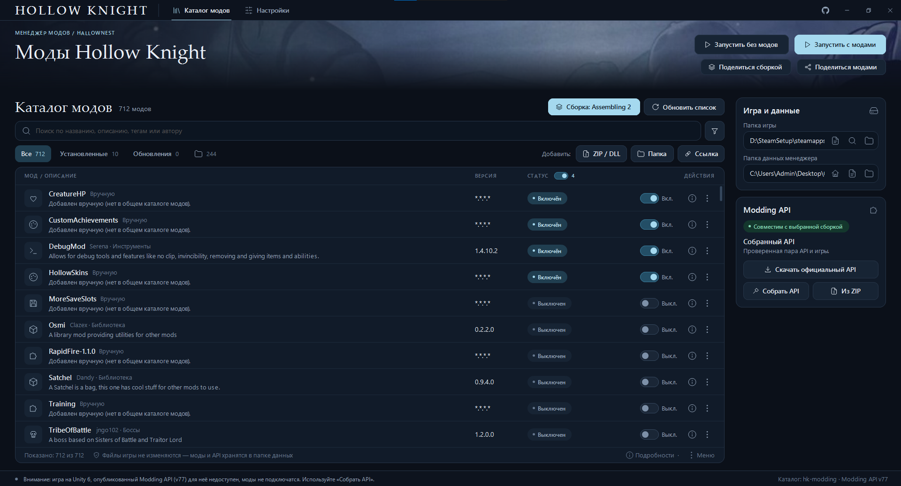

</div>

> **Безопасно для вашей игры.** Hallownest Forge не ломает и не изменяет данные игры Hollow Knight — моды, Modding API и резервные копии хранятся в собственной папке данных программы, а установка игры остаётся нетронутой.

---

## Скачать

Скачайте **`HallownestForge.exe`** из [последнего релиза](https://github.com/SilentPixel-art/HallownestForge/releases/latest) и запустите. Установщика нет, больше ничего ставить не нужно.

## Требования

- Windows 10 (версия 1903 и новее) или Windows 11
- Установленный Hollow Knight
- Интернет для каталога модов и загрузки модов

Программа — один `.exe` размером около 1 МБ на .NET Framework 4.8, который уже входит в Windows 10 (1903+) и Windows 11.

## Возможности

### Modding API — собственная сборка из файлов вашей игры

Карточка *Modding API* в настройках даёт три способа подключить API и показывает значок, подходит ли API к выбранной сборке игры:

- **Скачать официальный API** — готовый API в один клик.
- **Собрать API** — сборка Modding API из файлов вашей игры: API и игра образуют проверенную пару.
- **Из ZIP** — установка уже имеющегося архива с API.

<p align="center">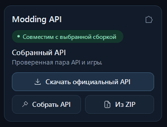</p>

Что ещё есть для API:

- **Автоподключение API** — API подключается при каждом запуске игры (программа должна быть открыта или в трее).
- **Журнал сборки API** открывается в один клик, если что-то пошло не так.
- **Не ломает данные игры.** Файлы игры не изменяются — моды и API хранятся в собственной папке данных программы.
- **Сборка API придерживается Unity 6** — она делается из собственных сборок игры на Unity 6, поэтому API соответствует текущей версии игры.
- Если опубликованный API ещё не поддерживает текущую сборку игры (например, новую сборку на Unity 6), **«Собрать API»** всё равно заставит моды работать.
- Для сборки нужен .NET SDK 10; если его нет, программа предложит скачать его с официального сайта Microsoft в собственную папку — права администратора не нужны.

### Каталог модов

- Сотни модов из каталога **hk-modding** с описаниями, авторами и тегами.
- Мгновенный **поиск** (`F3`) и **фильтры**: сортировка, зависимости, статус установки и теги — клик по тегу включает его, второй клик исключает, третий сбрасывает. Переключатель «Нужны все выбранные теги сразу» требует совпадения со всеми тегами.
- **Установка, обновление, отключение и удаление** модов в один клик; **Обновить все моды** и необязательное **автообновление**.
- **Зависимости** ставятся вместе с модом (можно отключить).
- Добавление мода **из файла, папки или ссылки** из буфера обмена (`Ctrl+V`).

<p align="center"></p>

<p align="center">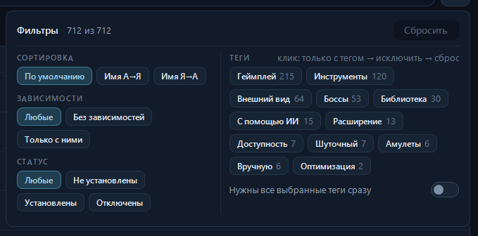</p>

### Просмотр скриншотов

У каждого мода есть галерея. Встроенный просмотрщик поддерживает миниатюры, масштаб, «вписать в окно», полный экран и управление с клавиатуры.

<p align="center">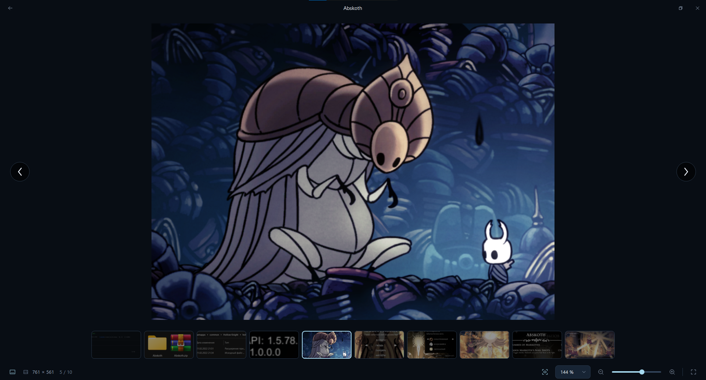</p>

### Сборки модов

Сохраняйте набор включённых модов как **сборку**, переключайтесь между сборками в один клик (`Alt+0…9`), переименовывайте и удаляйте их, начинайте с пустой («всё выключено») и **упаковывайте сборку в zip**, чтобы поделиться ею. Импорт сборок тоже поддерживается.

<p align="center">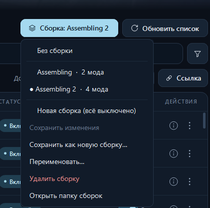</p>

### Поделиться модами

Кнопки **«Поделиться сборкой»** и **«Поделиться модами»** упаковывают выбранное в zip. Можно взять все установленные моды, только включённые, только скачанные из каталога, только добавленные вручную — и по желанию приложить сохранения модов.

<p align="center">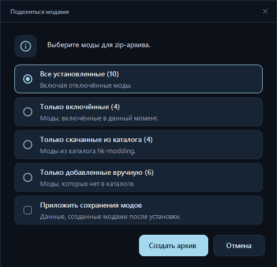</p>

### Запуск и ярлыки

- **Запуск с модами** и без модов.
- **Ярлыки на рабочем столе и в меню «Пуск»** для запуска с модами, без модов или для конкретной сборки — со своим значком.

<p align="center">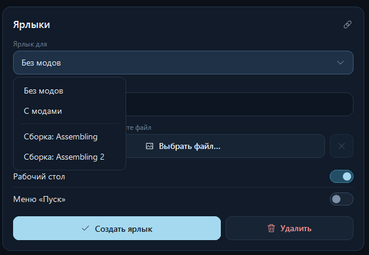</p>

### Диагностика и откат

Если игра неожиданно закрылась, **Диагностика** разбирает журналы и показывает подозрительные моды с вероятностью для каждого — отметьте виновников и отключите их в один клик.
Необязательные **резервные копии версий** позволяют откатить моды к более ранней версии.

<p align="center">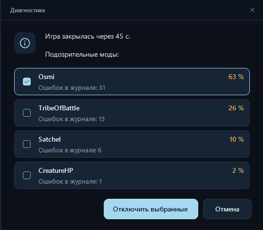</p>

### AppDataMOD — файлы модов отдельно от AppData

Один переключатель переносит файлы, которые моды пишут в AppData, в отдельную папку **AppDataMOD** (сохранения игры не затрагиваются, путь к `ModLog.txt` меняется вместе с ней). Папку можно открыть или очистить в настройках.
Сохранения удалённых модов хранятся в **ModData**, пока вы не попросите программу их удалять.

<p align="center">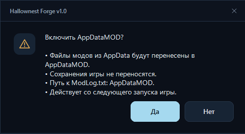</p>

<p align="center">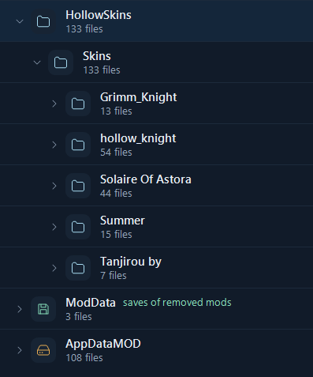</p>

### Баннер

Свой **баннер** в шапке — выберите файл, вставьте через `Ctrl+V` или перетащите картинку (анимации поддерживаются). Подгонка, выравнивание, заполнение пустых областей с размытием, растушёвка снизу и сжатие настраиваются с живым предпросмотром.

<p align="center">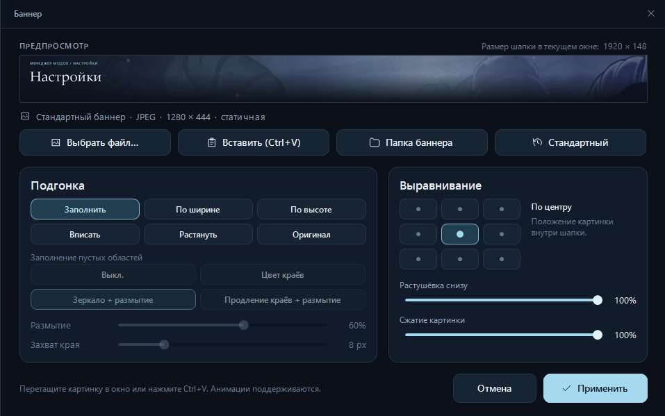</p>

### Остальное

- **11 языков интерфейса** и редактируемые файлы переводов `.lang` (см. [Языки](#языки)).
- Работа из трея, запуск вместе с Windows, масштаб интерфейса (от 100 %).
- Полное управление с клавиатуры — **F1** показывает все горячие клавиши.
- Подсказки у элементов управления.

<p align="center">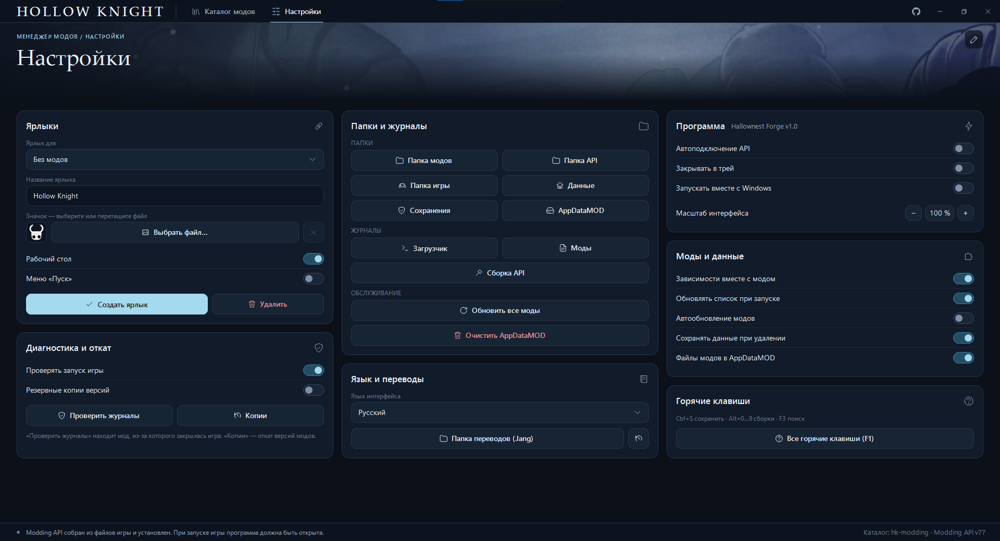</p>

## Языки

Deutsch · English · Español · Français · Italiano · Português (Brasil) · Русский · 日本語 · 简体中文 · 繁體中文 · 한국어

Переводы — обычные текстовые файлы `.lang`. Откройте **Настройки → Папка переводов (.lang)**, измените или добавьте файл — язык появится в списке.

<p align="center">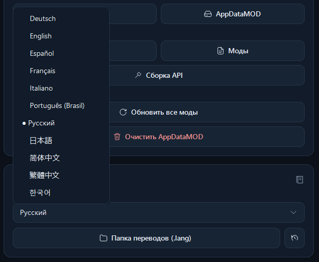</p>

## Где хранятся данные

Всё, что сохраняет программа, лежит в `%LOCALAPPDATA%\HallownestForge` (настройки, сборки, резервные копии, журналы, `AppDataMOD`, `ModData`).

Журналы диагностики (`launch.log`, `hkloader_boot.log`, `crash.log`) лежат в той же папке. Журнал сборки API открывается в **Настройки → Сборка API**.

## Сборка из исходников

Программа написана на C# (WinForms + GDI+) под .NET Framework 4.8; внутриигровой загрузчик `hkloader` — нативный C++, он вшивается в exe.

Для сборки нужны:

- .NET SDK 6 или новее (только для сборки) и интернет при первой сборке
- Python 3
- Visual Studio Build Tools (C++) **или** MinGW-w64 — для `hkloader.dll`, если его нет рядом со скриптом

```bat
python build.py
```

Результат — `HallownestForge.exe`; ошибки сборки пишутся в `build.log`.

## Благодарности и примечания

- Hollow Knight — игра Team Cherry. Hallownest Forge — неофициальный фанатский инструмент, не связанный с Team Cherry.
- Каталог модов и Modding API предоставляет сообщество [hk-modding](https://github.com/hk-modding). Все моды принадлежат своим авторам.
- Об ошибках и идеях пишите в [Issues](https://github.com/SilentPixel-art/HallownestForge/issues).
